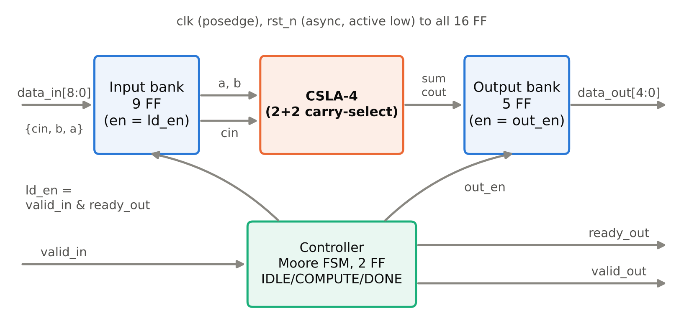
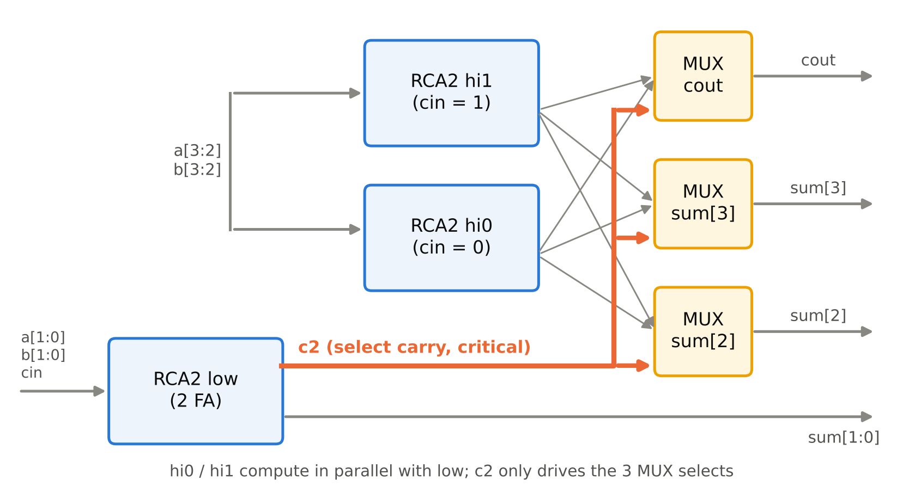
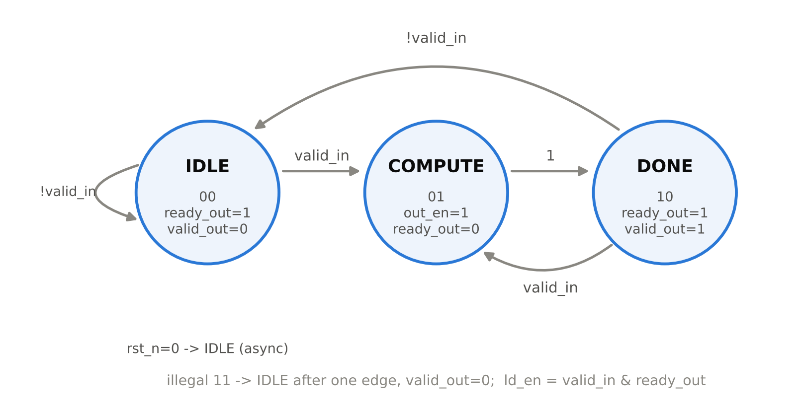
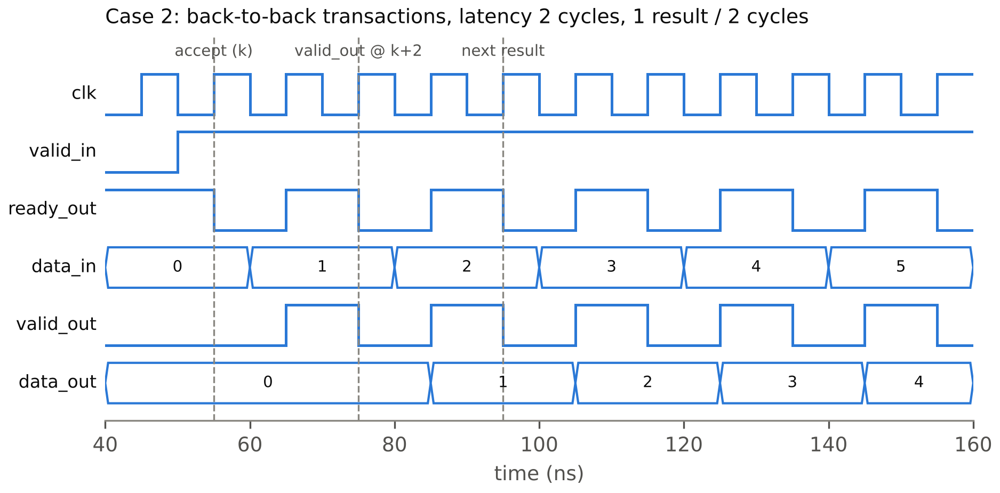
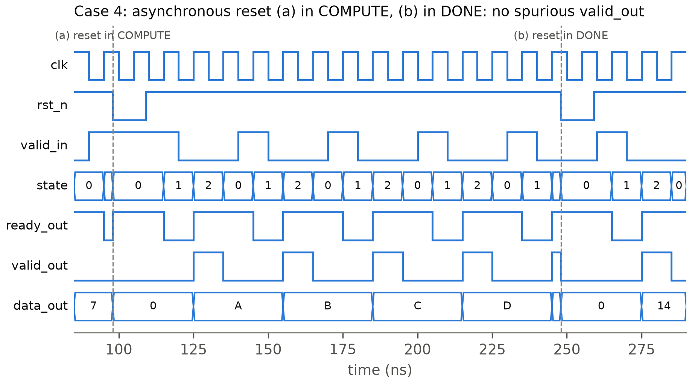

# Thiết kế và kiểm chứng chức năng

## Thiết kế

### Kiến trúc tổng thể

Hình 1 là sơ đồ khối của lõi `carryselect4_top`. Dữ liệu vào 9 bit `{cin, b[3:0], a[3:0]}` được chốt vào thanh ghi vào khi có giao dịch. Khối CSLA-4 là logic tổ hợp, tính tổng từ nội dung thanh ghi vào, và kết quả 5 bit `{cout, sum[3:0]}` được chốt vào thanh ghi ra. Bộ điều khiển FSM sinh tín hiệu cho phép nạp hai thanh ghi và các tín hiệu bắt tay.

Bảng: Danh sách chân của `carryselect4_top`
| Chân | Hướng | Độ rộng | Mô tả |
|---|---|---|---|
| `clk` | vào | 1 | clock, kích cạnh lên |
| `rst_n` | vào | 1 | reset bất đồng bộ, tích cực mức thấp |
| `valid_in` | vào | 1 | phía gửi báo `data_in` hợp lệ |
| `data_in` | vào | 9 | `{cin, b[3:0], a[3:0]}` |
| `ready_out` | ra | 1 | lõi sẵn sàng nhận giao dịch mới |
| `valid_out` | ra | 1 | `data_out` hợp lệ |
| `data_out` | ra | 5 | `{cout, sum[3:0]} = a + b + cin` |

### Datapath CSLA 2+2

CSLA-4 gồm 6 Full Adder chia thành 3 RCA 2 bit, cộng 3 MUX 2:1 (Hình 2). Khối low cộng `a[1:0] + b[1:0] + cin` và cho ra `sum[1:0]` cùng nhớ `c2`. Hai khối hi0 và hi1 cùng cộng `a[3:2] + b[3:2]`, một khối có nhớ vào cố định bằng 0 và khối kia bằng 1. Ba MUX dùng `c2` làm tín hiệu chọn: khi `c2 = 0` chúng lấy `sum[2]`, `sum[3]` và `cout` từ hi0, khi `c2 = 1` thì lấy từ hi1.

Đường tới hạn của khối tổ hợp đi qua hai Full Adder của khối low rồi tới chân chọn của MUX. Nếu để mặc định, bộ tổng hợp có thể dựng lại mạch thành một bộ cộng khác và làm mất cấu trúc CSLA. Vì thế nhóm gắn thuộc tính `(* keep_hierarchy *)` cho module `fa` và `mux2` (quyết định D-6).

### Thanh ghi

Thiết kế có {{synth.top.ff_count}} flip-flop, tất cả kích cạnh lên `clk` và reset bất đồng bộ mức thấp. Thanh ghi vào 9 bit (`a_q`, `b_q`, `cin_q`) nạp khi `ld_en = 1`. Thanh ghi ra 5 bit (`sum_q`, `cout_q`) nạp khi `out_en = 1`. Thanh ghi trạng thái FSM có 2 bit.

Theo quyết định D-1, `rst_n = 0` xóa cả 16 FF về 0, trong khi đề cương chỉ yêu cầu xóa thanh ghi ra. Nhóm xóa luôn thanh ghi vào để mô phỏng không còn giá trị X, và việc này không tốn thêm diện tích đáng kể. Sau tổng hợp thiết kế có {{synth.top.latch_count}} latch.

### Bộ điều khiển FSM

Bộ điều khiển là FSM Moore 3 trạng thái (quyết định D-2). Mã hóa và ngõ ra nằm trong Bảng 3, sơ đồ chuyển trạng thái ở Hình 3.

Bảng: Mã hóa trạng thái và ngõ ra của FSM
| Trạng thái | Mã | `ready_out` | `valid_out` | `out_en` | Trạng thái kế |
|---|---|---|---|---|---|
| IDLE | `2'b00` | 1 | 0 | 0 | `valid_in` ? COMPUTE : IDLE |
| COMPUTE | `2'b01` | 0 | 0 | 1 | DONE |
| DONE | `2'b10` | 1 | 1 | 0 | `valid_in` ? COMPUTE : IDLE |
| (không hợp lệ) | `2'b11` | 0 | 0 | 0 | IDLE |

Thanh ghi vào nạp khi `ld_en = valid_in & ready_out`, tức là giao dịch được nhận ở IDLE hoặc DONE. Ở DONE, nếu `valid_in = 1` thì FSM sang thẳng COMPUTE: kết quả cũ được xuất và giao dịch mới được nhận trong cùng một chu kỳ, không mất chu kỳ nào.

### Định nghĩa độ trễ và thông lượng

Theo quyết định D-4, gọi *k* là cạnh lên mà tại đó lấy mẫu được `valid_in & ready_out = 1` (cạnh nhận). Ở cạnh *k* FSM chuyển sang COMPUTE. Ở cạnh *k + 1* thanh ghi ra được nạp và FSM sang DONE. Vì vậy `valid_out` được lấy mẫu bằng 1 tại cạnh *k + 2*, và độ trễ (latency) là {{sim.latency_cycles}} chu kỳ.

Khi `valid_in` luôn bằng 1, hai cạnh nhận liên tiếp cách nhau 2 cạnh. Thông lượng là 1 kết quả mỗi {{sim.cycles_per_result}} chu kỳ.

## Kiểm chứng chức năng

### Kiến trúc testbench

Nhóm dùng một testbench SystemVerilog tự kiểm tra (`verif/tb/tb_top.sv`), biên dịch và chạy bằng Verilator với `--binary --timing`. Bộ phát kích thích gồm hai task `send` và `idle`, lái `valid_in` và `data_in` đồng bộ theo clock và chỉ đổi giá trị ở cạnh xuống. Mỗi giao dịch được nhận (`valid_in & ready_out = 1` tại cạnh lên) đẩy kết quả mong đợi vào hàng đợi của scoreboard. Mỗi lần `valid_out = 1`, scoreboard lấy một phần tử ra và so với `data_out`.

Một monitor chạy song song, kiểm tra bốn điều: độ trễ đúng 2 chu kỳ, khoảng cách giữa hai lần nhận, `valid_out` không xuất hiện khi scoreboard rỗng, và `data_out` không đổi giữa hai xung `valid_out`. Thêm một watchdog để dừng mô phỏng báo lỗi nếu testbench bị treo.

Mỗi kịch bản in một dòng `RESULT <case> PASS|FAIL checked=<n> errors=<m>`. Makefile đọc dòng này rồi ghi trạng thái vào `results/metrics.json`, nên không có số nào do nhóm gõ tay. Lệnh chạy là `make sim TEST=<case>`, hoặc `make sim-all` để chạy hết.

### Mô hình tham chiếu và vector

Mô hình tham chiếu là một script Python độc lập (`verif/golden/golden.py`) có test riêng bằng pytest. Script sinh hai file vector dạng hex. `case1.hex` có 6 bộ ba (*a*, *b*, *cin*) có hướng, gồm các góc như 0 + 0 + 0 và 15 + 15 + 1. `exhaustive.hex` có đủ 512 tổ hợp của *a* (4 bit), *b* (4 bit) và *cin* (1 bit).

Mỗi dòng là một word 14 bit: 9 bit cao là `data_in = {cin, b, a}`, 5 bit thấp là kết quả mong đợi `{cout, sum}`. Testbench đọc file bằng `$readmemh`, nên kết quả mong đợi luôn đến từ mô hình Python và testbench không tự tính lại.

### Ma trận kịch bản

Bảng: Các kịch bản kiểm chứng và kết quả
| Case | Kịch bản | Điểm kiểm tra chính | Kết quả |
|---|---|---|---|
| 1 | Vector có hướng sau reset | giá trị biên, giao dịch đơn lẻ | {{sim.case1.status}} |
| 2 | Giao dịch liên tiếp (`valid_in` luôn bằng 1) | độ trễ, thông lượng, `data_out` giữ nguyên | {{sim.case2.status}} |
| 3 | Bong bóng ngẫu nhiên 30% trên `valid_in` | không mất, không lặp giao dịch | {{sim.case3.status}} |
| 4 | Reset bất đồng bộ ở COMPUTE và ở DONE | không có `valid_out` giả sau reset | {{sim.case4.status}} |
| 5 | Vét cạn {{sim.exhaustive.checked}} tổ hợp | {{sim.exhaustive.errors}} lỗi so với mô hình tham chiếu | {{sim.case5.status}} |
| illegal | Ép FSM vào trạng thái `2'b11` | về IDLE sau một cạnh, không phát `valid_out` | {{sim.case_illegal.status}} |

Khối tổ hợp `csla4` còn được kiểm riêng, so với `rca4` làm tham chiếu, trên {{sim.unit_csla4.checked}} tổ hợp và có {{sim.unit_csla4.errors}} lỗi.

### Bằng chứng mutation test

Một testbench báo PASS chưa chứng minh được gì nếu nó không bắt được lỗi. Vì vậy nhóm cố ý sửa sai RTL (mutation), chạy lại kịch bản liên quan, rồi khôi phục file gốc bằng `git checkout`.

Bảng: Kết quả mutation test (trích `results/logs/t4.txt`, `t5.txt`)
| Đột biến | Kịch bản | Kết quả |
|---|---|---|
| Đảo chân chọn của `mux2` | case5 | FAIL, 512/512 sai |
| `valid_out = DONE \| COMPUTE` | case1 | FAIL: sai độ trễ, `valid_out` khi scoreboard rỗng |
| `ready_out = 1` | case2, case3 | FAIL: khoảng cách nhận sai, sai dữ liệu |
| `out_en = 1` và `ld_en = 1` | case2, case3 | FAIL: `data_out` đổi khi không có `valid_out` |
| Xóa nhánh `default` của FSM | case_illegal | FAIL: không về IDLE, `valid_out` giả |
| `default: state_next = state` | case_illegal | FAIL: kẹt ở `2'b11`, watchdog dừng |

Hai đột biến cho nhóm bài học riêng. Đột biến chỉ đặt `out_en = 1` vẫn PASS. Nhóm xem lại và thấy đây là đột biến tương đương: thanh ghi vào chỉ đổi khi có giao dịch được nhận, nên nạp thanh ghi ra mỗi chu kỳ vẫn cho đúng dạng sóng `data_out` cũ. Nhóm không sửa testbench để bắt một lỗi không quan sát được, mà chỉ đổi sang đột biến mạnh hơn (`out_en = 1` cùng `ld_en = 1`).

Đột biến xóa nhánh `default` lúc đầu cũng lọt. Mô phỏng giữ lại giá trị cũ của `state_next`, và khi ép FSM vào `2'b11` từ IDLE thì giá trị cũ đó lại là IDLE. Nhóm thêm biến thể (b) cho case_illegal: ép `2'b11` từ DONE khi `valid_in = 1`, lúc `state_next` cũ là COMPUTE. Biến thể này làm FSM sang COMPUTE rồi DONE và phát `valid_out` giả, nên testbench bắt được.

### Dạng sóng, độ trễ và thông lượng

Hình 4 là 12 chu kỳ đầu của case 2. Giao dịch đầu tiên được nhận tại cạnh 55 ns (cạnh *k*), và `valid_out` được lấy mẫu bằng 1 tại cạnh *k + 2* = 75 ns, đúng với định nghĩa ở quyết định D-4. Khi `valid_in` giữ bằng 1, FSM luân phiên giữa COMPUTE và DONE. Độ trễ đo được là {{sim.latency_cycles}} chu kỳ và cứ {{sim.cycles_per_result}} chu kỳ có một kết quả.

Hình 5 là case 4. Ở lần (a), `rst_n` xuống 0 khi FSM đang ở COMPUTE: giao dịch đang xử lý bị hủy, FSM về IDLE và thanh ghi ra bị xóa. Ở lần (b), reset đến khi FSM đang ở DONE với `valid_out = 1`. Vì reset bất đồng bộ nên `valid_out` tắt ngay, và sau khi nhả reset không có xung giả nào xuất hiện.

