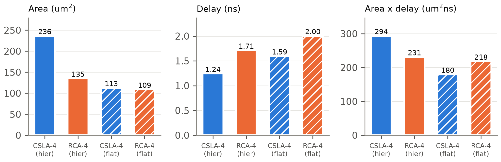
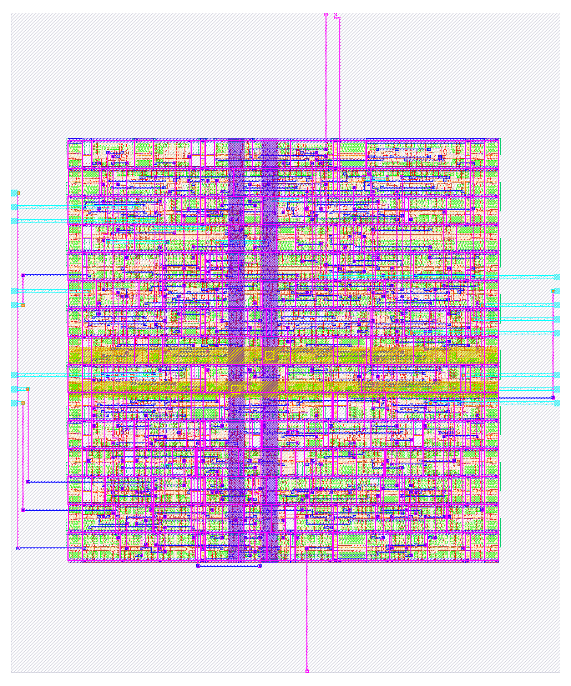

# Tổng hợp và thiết kế vật lý

## Tổng hợp và phân tích thời gian tĩnh

### Tổng hợp bằng Yosys

Script `syn/synth.ys` đọc các file RTL, giữ phân cấp của `fa` và `mux2` (quyết định D-6), chạy `synth`, rồi ánh xạ flip-flop bằng `dfflibmap` và logic tổ hợp bằng `abc` với liberty `sky130_fd_sc_hd__tt_025C_1v80.lib`. Nhóm làm khác đề cương ở hai chỗ, đều ghi trong `docs/DEVIATIONS.md`.

Chỗ thứ nhất là D2. Lúc đầu các flip-flop trong netlist chỉ có tên kiểu `_28_`, nên report STA không cho biết đường đi qua thanh ghi nào. Nhóm thêm `rename -wire` để cell mang tên wire nó điều khiển, ví dụ `a_q[0]`. Logic và diện tích không đổi. Chỗ thứ hai là D3. ABC đã chọn 3 cell `lpflow_isobufsrc_1` (cell cách ly dùng cho power gating) làm logic thường trong `csla4_ctrl`, nên nhóm loại các cell `lpflow_*` khỏi ánh xạ, giống cách LibreLane làm. ABC chuyển sang `nor2b_1`, số cell và diện tích giữ nguyên.

### Ràng buộc thời gian (SDC)

File `syn/constraints.sdc` dùng chung cho tổng hợp, STA và LibreLane (quyết định D-7). Clock `clk` có chu kỳ 10 ns, `set_clock_uncertainty` 0.25 ns và `set_clock_transition` 0.15 ns. Mọi ngõ vào trừ `clk` có `set_input_delay` 2 ns, kể cả `rst_n`, và mọi ngõ ra có `set_output_delay` 2 ns. Ngõ vào được lái bởi `sky130_fd_sc_hd__inv_2`, ngõ ra mang tải `set_load` 0.0334 pF.

### Diện tích

Bảng: Kết quả tổng hợp `carryselect4_top`
| Chỉ số | Giá trị |
|---|---|
| Số cell | {{synth.top.cell_count}} |
| Số flip-flop / latch | {{synth.top.ff_count}} / {{synth.top.latch_count}} |
| Diện tích cell (µm²) | {{synth.top.area_um2}} |
| Diện tích NAND2 (µm²) | {{synth.nand2_area_um2}} |
| NAND2 tương đương | {{synth.top.nand2_eq}} |
| Ngân sách đề cương | 500 |

NAND2 tương đương được tính theo quyết định D-5: tổng diện tích cell chia cho diện tích `sky130_fd_sc_hd__nand2_1` đọc từ liberty. Thiết kế dùng chưa tới một nửa ngân sách 500 cổng.

### Phân tích thời gian tĩnh (OpenSTA)

Nhóm chạy OpenSTA ở corner tt (25 °C, 1.8 V) với clock lý tưởng.

Bảng: Kết quả STA sau tổng hợp (corner tt, chu kỳ 10 ns)
| Kiểm tra | Đường | Slack (ns) |
|---|---|---|
| Setup xấu nhất (toàn thiết kế) | `{{sta.synth.worst_path}}` | {{sta.synth.wns_setup_ns}} |
| Hold xấu nhất | trạng thái FSM | {{sta.synth.wns_hold_ns}} |
| Đường tới hạn thanh ghi–thanh ghi | `{{sta.synth.crit_path}}` | thời điểm đến {{sta.synth.crit_arrival_ns}} ns |

Theo D1, các key `wns_*` lưu worst slack (dương khi đạt timing) chứ không phải WNS của OpenSTA, vì WNS luôn bằng 0 khi không có vi phạm và không cho biết còn dư bao nhiêu. Đường setup xấu nhất toàn thiết kế bắt đầu từ cổng vào `valid_in`, do input delay 2 ns đã chiếm sẵn một phần chu kỳ. Đường adder thật sự chỉ hiện ra trong report thanh ghi–thanh ghi riêng. Nó đi đúng qua cấu trúc CSLA: hai cổng `maj3` của khối low tạo `c2`, rồi tới chân chọn của MUX.

Bảng: Đường tới hạn `a_q[0] → cout_q` (trích `results/logs/t6_sta.txt`)
| Chân | Cell | Trễ (ns) | Thời điểm (ns) |
|---|---|---|---|
| `a_q[0]/Q` | `dfrtp_1` | 0.418 | 0.418 |
| `u_low/u_fa0/cout` | `maj3_1` | 0.367 | 0.785 |
| `u_low/u_fa1/cout` (= `c2`) | `maj3_1` | 0.401 | 1.187 |
| `u_mux_co/y` (chân S → X) | `mux2_1` | 0.316 | 1.503 |
| MUX ngõ ra (`out_en`) | `mux2_1` | 0.281 | 1.784 |
| `cout_q/D` | `dfrtp_1` | – | 1.784 |

### So sánh Area–Delay giữa CSLA-4 và RCA-4

Để so sánh công bằng, nhóm tổng hợp riêng hai bộ cộng tổ hợp `csla4` và `rca4`, mỗi bộ hai biến thể: giữ phân cấp như thiết kế cuối, và cho phép flatten. Cả bốn biến thể dùng đúng flow của chương này, kể cả `-dont_use` cho `lpflow_*`. Độ trễ là thời điểm đến dài nhất từ ngõ vào tới ngõ ra, đo với clock ảo, input/output delay bằng 0 ở corner tt.

Bảng: So sánh diện tích và độ trễ (Task 7)
| Biến thể | Diện tích (µm²) | NAND2 tđ | Số cell | Trễ (ns) | ADP (µm²·ns) |
|---|---|---|---|---|---|
| CSLA-4 (phân cấp) | {{cmp.csla4.area_um2}} | {{cmp.csla4.nand2_eq}} | {{cmp.csla4.cell_count}} | {{cmp.csla4.delay_ns}} | {{cmp.csla4.adp}} |
| RCA-4 (phân cấp) | {{cmp.rca4.area_um2}} | {{cmp.rca4.nand2_eq}} | {{cmp.rca4.cell_count}} | {{cmp.rca4.delay_ns}} | {{cmp.rca4.adp}} |
| CSLA-4 (flatten) | {{cmp.csla4_flat.area_um2}} | {{cmp.csla4_flat.nand2_eq}} | {{cmp.csla4_flat.cell_count}} | {{cmp.csla4_flat.delay_ns}} | {{cmp.csla4_flat.adp}} |
| RCA-4 (flatten) | {{cmp.rca4_flat.area_um2}} | {{cmp.rca4_flat.nand2_eq}} | {{cmp.rca4_flat.cell_count}} | {{cmp.rca4_flat.delay_ns}} | {{cmp.rca4_flat.adp}} |

Khi giữ phân cấp, CSLA nhanh hơn RCA ({{cmp.csla4.delay_ns}} so với {{cmp.rca4.delay_ns}} ns) nhưng diện tích lớn gần gấp đôi, nên tích diện tích–độ trễ (ADP) của nó kém hơn RCA.

Khi cho flatten, ABC thu nhỏ diện tích mạnh (CSLA giảm khoảng một nửa) nhưng cả hai bộ cộng đều chậm đi. CSLA flatten vẫn nhanh hơn RCA flatten và có ADP tốt nhất trong bốn biến thể. Đường dài nhất của bản flatten kết thúc bằng các cổng nhỏ như `o21ai_0` sau hai tầng `maj3`, còn bản phân cấp giữ nguyên `fa` là `maj3_1` cộng `xor3_1`.

Thiết kế cuối dùng bản giữ phân cấp (D-6), nên ưu thế tốc độ của CSLA là thật nhưng phải trả bằng diện tích. Nhóm chưa kiểm chứng nguyên nhân. Hai giả thuyết là ABC ưu tiên diện tích hơn tốc độ khi ánh xạ, và 4 bit quá ngắn để carry-select phát huy hết lợi thế.

Thứ hạng của hai bản flatten còn phụ thuộc phiên bản công cụ (D6). Khi chạy thử trong một môi trường khác (Yosys 0.70, liberty `open_pdks` 1.0.471), các bản flatten ra số khác và thứ tự CSLA/RCA đảo ngược; chạy lại trên máy nhóm với Yosys 0.66 và PDK ciel thì ra đúng các số trong bảng. Vì vậy nhóm chỉ rút kết luận chắc chắn từ so sánh giữa hai bản giữ phân cấp.

## Thiết kế vật lý

### Luồng OpenLane 2 / LibreLane

Nhóm dùng LibreLane 3.0.16 (bản kế tục OpenLane 2) với file cấu hình `pnr/config.json`. Các thông số chính là `CLOCK_PERIOD = 10`, `FP_CORE_UTIL = 55`, `FP_ASPECT_RATIO = 1` và `SYNTH_HIERARCHY_MODE = keep` để giữ phân cấp CSLA (D-6). `PNR_SDC_FILE` và `SIGNOFF_SDC_FILE` đều trỏ tới `syn/constraints.sdc`, cùng file với mục 3.1.2. Lệnh chạy là `make pnr` (`scripts/run_pnr.sh 10 run_10ns`).

Luồng đi qua bảy bước. Đầu tiên là tổng hợp bằng Yosys cùng các kiểm tra lint, latch và cell chưa ánh xạ. Sau đó là floorplan, với kích thước die tính theo utilization 55% và tỷ lệ 1:1, có chèn tap cell và end cap. Mạng cấp nguồn (PDN) gồm lưới VPWR/VGND trên met4/met5 và rail met1 theo hàng cell. Bước placement đặt chân I/O rồi chạy global và detailed placement. CTS dựng cây clock và sửa timing bằng cách chèn buffer. Bước routing gồm global route, sửa antenna, detailed route và chèn fill/decap. Cuối cùng là sign-off: trích RC, STA ở 9 corner, DRC bằng Magic và KLayout, LVS bằng Netgen và xuất GDSII.

Flow chạy bằng `make pnr` ở chế độ `--dockerized`, với image `ghcr.io/librelane/librelane:3.0.16` và PDK sky130A do ciel quản lý (hash `{{env.pdk_hash}}`). Mọi số `pnr.*` và `pnr5.*` trong tài liệu được đo bằng chế độ này (xem D4). Lệnh `docker run -it` của LibreLane cần một TTY, nên khi chạy từ script không có terminal thì `run_pnr.sh` bọc lệnh bằng `script`.

### Kết quả sign-off

Bảng: Kết quả sau đặt–đi dây ở chu kỳ 10 ns
| Chỉ số | Giá trị |
|---|---|
| Diện tích die (µm²) | {{pnr.die_area_um2}} |
| Số standard cell (gồm tap, không gồm fill) | {{pnr.cell_count}} |
| Utilization cuối (%) | {{pnr.core_util_pct}} |
| Setup slack ở tt / corner xấu nhất (ns) | {{pnr.wns_setup_ns}} / {{pnr.wns_setup_worst_corner_ns}} |
| Hold slack ở tt / corner xấu nhất (ns) | {{pnr.wns_hold_ns}} / {{pnr.wns_hold_worst_corner_ns}} |
| fmax ước lượng ở tt (MHz) | {{pnr.fmax_mhz}} |
| Lỗi DRC Magic / KLayout | {{pnr.drc_magic}} / {{pnr.drc_klayout}} |
| Lỗi LVS | {{pnr.lvs_errors}} |
| Vi phạm antenna | {{pnr.antenna_violations}} |
| Công suất tổng (mW) | {{pnr.power_total_mw}} |
| Chiều dài dây (µm) | {{pnr.wirelength_um}} |

Setup và hold slack đều dương ở cả 9 corner (trích RC min/nom/max, kết hợp ss/tt/ff), kể cả corner chậm nhất `max_ss_100C_1v60`. Các kiểm tra recovery và removal của `rst_n` nằm trong nhóm đường `asynchronous` và đã được tính vào slack này. Nhóm kiểm tra cả 9 corner chứ không chỉ corner tt, vì setup slack xấu nhất nằm ở corner ss.

fmax được ước lượng bằng 1000 / (*T* − *s*) MHz, với *T* = 10 ns và *s* là setup slack ở tt (worst slack, D1). Slack này tính cả đường I/O, mà input/output delay cố định 2 ns không đổi theo chu kỳ, nên *T* − *s* là chu kỳ nhỏ nhất mà đường chặt nhất chịu được. Đây là tần số ước lượng ở corner tt, chưa phải giá trị đã sign-off.

Utilization cuối cao hơn mục tiêu 55%. Lý do là sau floorplan, các bước sửa timing chèn thêm buffer (gồm buffer hold), trong khi die vẫn giữ nguyên kích thước tính ở floorplan. Nhóm giữ nguyên cấu hình 55% theo đề cương và ghi nhận chênh lệch này thay vì chỉnh số để cho đẹp.

### Chạy mở rộng ở 5 ns

{{pnr5.text_vi}}

### Sai khác so với đề cương

Mọi sai khác đều nằm trong `docs/DEVIATIONS.md`. Với phần vật lý và tổng hợp có năm mục.

D1: các key `*.wns_*` lưu worst slack (dương khi đạt) thay cho WNS của OpenSTA, để biết còn dư bao nhiêu. D2: thêm `read_liberty -lib` và `rename -wire` để report STA đọc được tên thanh ghi; logic và diện tích không đổi. D3: loại cell `lpflow_*`, tránh dùng cell cách ly làm logic thường, giống cách LibreLane làm; số cell và diện tích không đổi.

D4: lần chạy đầu trong môi trường không có Docker dùng tool native và PDK `open_pdks` 1.0.471. Số trong tài liệu là số chạy lại bằng image LibreLane 3.0.16 và PDK ciel, còn số của lần đầu chỉ còn là lịch sử. Hai lần chạy cho kết luận 5 ns khác nhau, nên nhóm chỉ trích số của lần chạy chính thức. D5: bài báo dựng bằng TeX Live khi máy không có tectonic; nội dung và lớp IEEEtran không đổi.
