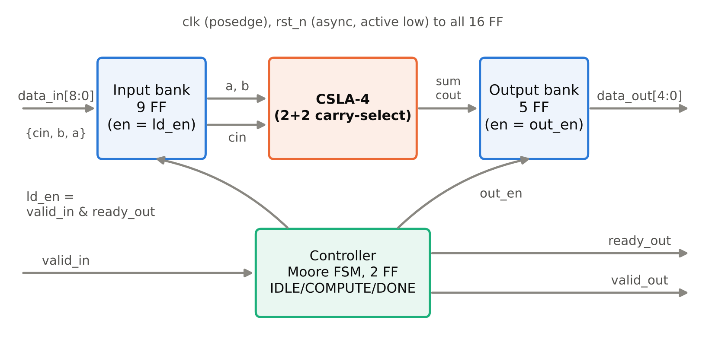
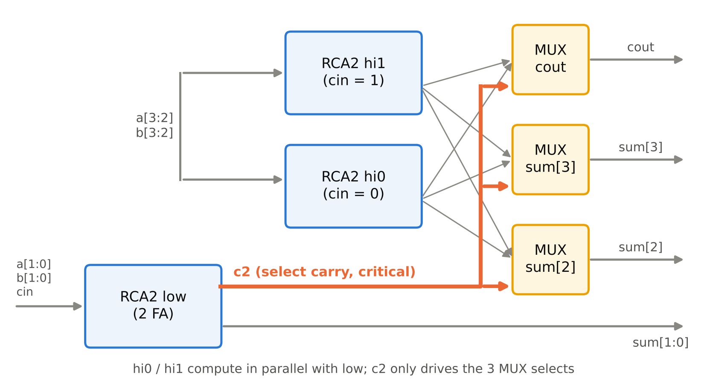
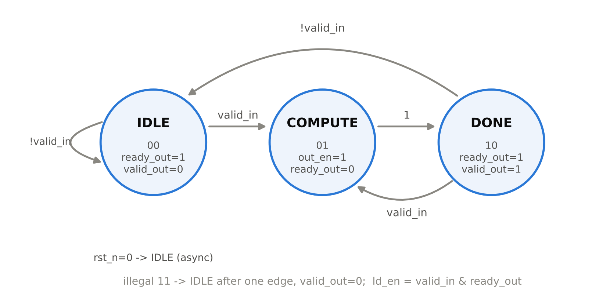

# Thiết kế

## Kiến trúc tổng thể

Hình 1 là sơ đồ khối của lõi `carryselect4_top`. Dữ liệu vào 9 bit gồm `{cin, b[3:0], a[3:0]}` được chốt vào thanh ghi vào khi có giao dịch. Khối CSLA-4 tổ hợp tính tổng từ nội dung thanh ghi vào, và kết quả 5 bit `{cout, sum[3:0]}` được chốt vào thanh ghi ra. Bộ điều khiển FSM sinh các tín hiệu cho phép nạp thanh ghi và các tín hiệu bắt tay.

Bảng: Danh sách chân của `carryselect4_top`
| Chân | Hướng | Độ rộng | Mô tả |
|---|---|---|---|
| `clk` | vào | 1 | clock, kích cạnh lên |
| `rst_n` | vào | 1 | reset bất đồng bộ, tích cực mức thấp |
| `valid_in` | vào | 1 | phía gửi báo `data_in` hợp lệ |
| `data_in` | vào | 9 | `{cin, b[3:0], a[3:0]}` |
| `ready_out` | ra | 1 | lõi sẵn sàng nhận giao dịch mới |
| `valid_out` | ra | 1 | `data_out` hợp lệ |
| `data_out` | ra | 5 | `{cout, sum[3:0]} = a + b + cin` |

## Datapath CSLA 2+2

Khối CSLA-4 gồm 6 Full Adder chia thành 3 RCA 2 bit và 3 MUX 2:1 (Hình 2):

- Khối **low** cộng `a[1:0] + b[1:0] + cin`, cho ra `sum[1:0]` và nhớ `c2`.
- Khối **hi0** cộng `a[3:2] + b[3:2]` với nhớ vào cố định bằng 0.
- Khối **hi1** cộng `a[3:2] + b[3:2]` với nhớ vào cố định bằng 1.
- Ba MUX dùng `c2` làm tín hiệu chọn để lấy `sum[2]`, `sum[3]` và `cout` từ hi0 (khi `c2 = 0`) hoặc hi1 (khi `c2 = 1`).

Đường tới hạn của khối tổ hợp đi qua hai Full Adder của khối low rồi qua chân chọn của MUX. Để bộ tổng hợp không tái cấu trúc CSLA thành một bộ cộng khác, module `fa` và `mux2` mang thuộc tính `(* keep_hierarchy *)` (quyết định D-6).

## Thanh ghi

Thiết kế có tổng cộng **{{synth.top.ff_count}} flip-flop**, tất cả kích cạnh lên `clk` và reset bất đồng bộ tích cực thấp:

- Thanh ghi vào 9 bit (`a_q`, `b_q`, `cin_q`), nạp khi `ld_en = 1`.
- Thanh ghi ra 5 bit (`sum_q`, `cout_q`), nạp khi `out_en = 1`.
- Thanh ghi trạng thái FSM 2 bit.

Theo quyết định D-1, `rst_n = 0` xóa **cả 16 FF** về 0 (đề cương chỉ yêu cầu xóa thanh ghi ra). Xóa thêm thanh ghi vào giúp mô phỏng không có giá trị X mà không tốn thêm diện tích đáng kể. Thiết kế không có latch (số latch sau tổng hợp: {{synth.top.latch_count}}).

## Bộ điều khiển FSM

Bộ điều khiển là FSM Moore 3 trạng thái (quyết định D-2), mã hóa và ngõ ra như Bảng 2; sơ đồ chuyển trạng thái ở Hình 3.

Bảng: Mã hóa trạng thái và ngõ ra của FSM
| Trạng thái | Mã | `ready_out` | `valid_out` | `out_en` | Trạng thái kế |
|---|---|---|---|---|---|
| IDLE | `2'b00` | 1 | 0 | 0 | `valid_in` ? COMPUTE : IDLE |
| COMPUTE | `2'b01` | 0 | 0 | 1 | DONE |
| DONE | `2'b10` | 1 | 1 | 0 | `valid_in` ? COMPUTE : IDLE |
| (không hợp lệ) | `2'b11` | 0 | 0 | 0 | IDLE |

Tín hiệu nạp thanh ghi vào là `ld_en = valid_in & ready_out`, nên giao dịch được nhận ở IDLE hoặc DONE. Trong DONE, nếu `valid_in = 1` thì FSM chuyển thẳng sang COMPUTE: kết quả cũ được xuất và giao dịch mới được nhận trong cùng một chu kỳ, không có chu kỳ chết.

## Định nghĩa độ trễ và thông lượng

Theo quyết định D-4: gọi *k* là cạnh lên mà tại đó lấy mẫu được `valid_in & ready_out = 1` (cạnh nhận). Tại cạnh *k* FSM chuyển sang COMPUTE, tại cạnh *k + 1* thanh ghi ra được nạp và FSM sang DONE, nên `valid_out` được lấy mẫu bằng 1 tại cạnh *k + 2*. Do đó:

- Độ trễ (latency) là **{{sim.latency_cycles}} chu kỳ**.
- Khi `valid_in` luôn bằng 1, hai cạnh nhận liên tiếp cách nhau 2 cạnh, tức thông lượng là 1 kết quả mỗi **{{sim.cycles_per_result}} chu kỳ**.
