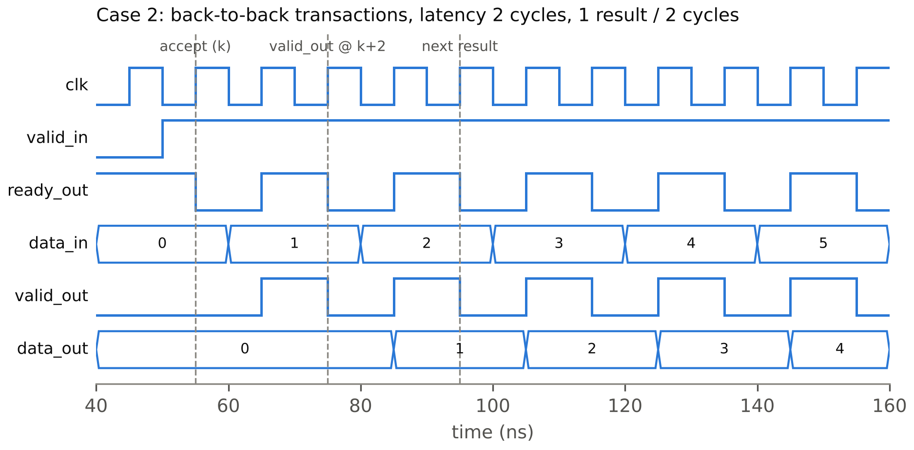
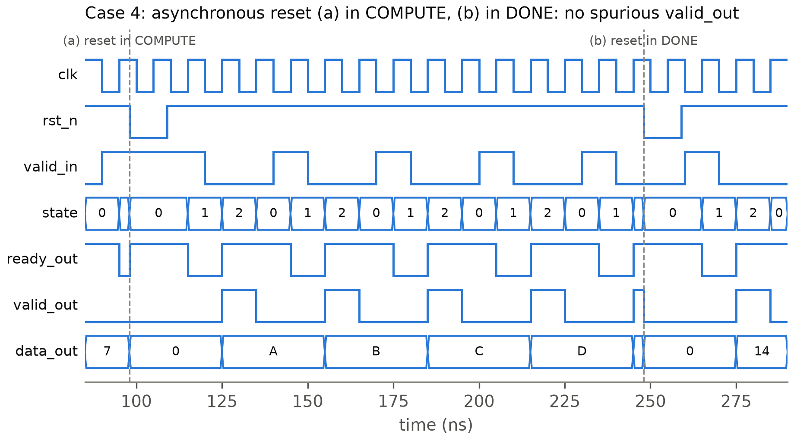

# Kiểm chứng chức năng

## Kiến trúc testbench

Nhóm dùng một testbench SystemVerilog tự kiểm tra (`verif/tb/tb_top.sv`), biên dịch và chạy bằng Verilator với `--binary --timing`. Bộ phát kích thích gồm hai task `send` và `idle`, lái `valid_in` và `data_in` đồng bộ theo clock và chỉ đổi giá trị ở cạnh xuống. Mỗi giao dịch được nhận (`valid_in & ready_out = 1` tại cạnh lên) đẩy kết quả mong đợi vào hàng đợi của scoreboard. Mỗi lần `valid_out = 1`, scoreboard lấy một phần tử ra và so với `data_out`.

Một monitor chạy song song, kiểm tra bốn điều: độ trễ đúng 2 chu kỳ, khoảng cách giữa hai lần nhận, `valid_out` không xuất hiện khi scoreboard rỗng, và `data_out` không đổi giữa hai xung `valid_out`. Thêm một watchdog để dừng mô phỏng báo lỗi nếu testbench bị treo.

Mỗi kịch bản in một dòng `RESULT <case> PASS|FAIL checked=<n> errors=<m>`. Makefile đọc dòng này rồi ghi trạng thái vào `results/metrics.json`, nên không có số nào do nhóm gõ tay. Lệnh chạy là `make sim TEST=<case>`, hoặc `make sim-all` để chạy hết.

## Mô hình tham chiếu và vector

Mô hình tham chiếu là một script Python độc lập (`verif/golden/golden.py`) có test riêng bằng pytest. Script sinh hai file vector dạng hex. `case1.hex` có 6 bộ ba (*a*, *b*, *cin*) có hướng, gồm các góc như 0 + 0 + 0 và 15 + 15 + 1. `exhaustive.hex` có đủ 512 tổ hợp của *a* (4 bit), *b* (4 bit) và *cin* (1 bit).

Mỗi dòng là một word 14 bit: 9 bit cao là `data_in = {cin, b, a}`, 5 bit thấp là kết quả mong đợi `{cout, sum}`. Testbench đọc file bằng `$readmemh`, nên kết quả mong đợi luôn đến từ mô hình Python và testbench không tự tính lại.

## Ma trận kịch bản

Bảng: Các kịch bản kiểm chứng và kết quả
| Case | Kịch bản | Điểm kiểm tra chính | Kết quả |
|---|---|---|---|
| 1 | Vector có hướng sau reset | giá trị biên, giao dịch đơn lẻ | {{sim.case1.status}} |
| 2 | Giao dịch liên tiếp (`valid_in` luôn bằng 1) | độ trễ, thông lượng, `data_out` giữ nguyên | {{sim.case2.status}} |
| 3 | Bong bóng ngẫu nhiên 30% trên `valid_in` | không mất, không lặp giao dịch | {{sim.case3.status}} |
| 4 | Reset bất đồng bộ ở COMPUTE và ở DONE | không có `valid_out` giả sau reset | {{sim.case4.status}} |
| 5 | Vét cạn {{sim.exhaustive.checked}} tổ hợp | {{sim.exhaustive.errors}} lỗi so với mô hình tham chiếu | {{sim.case5.status}} |
| illegal | Ép FSM vào trạng thái `2'b11` | về IDLE sau một cạnh, không phát `valid_out` | {{sim.case_illegal.status}} |

Khối tổ hợp `csla4` còn được kiểm riêng, so với `rca4` làm tham chiếu, trên {{sim.unit_csla4.checked}} tổ hợp và có {{sim.unit_csla4.errors}} lỗi.

## Bằng chứng mutation test

Một testbench báo PASS chưa chứng minh được gì nếu nó không bắt được lỗi. Vì vậy nhóm cố ý sửa sai RTL (mutation), chạy lại kịch bản liên quan, rồi khôi phục file gốc bằng `git checkout`.

Bảng: Kết quả mutation test (trích `results/logs/t4.txt`, `t5.txt`)
| Đột biến | Kịch bản | Kết quả |
|---|---|---|
| Đảo chân chọn của `mux2` | case5 | FAIL, 512/512 sai |
| `valid_out = DONE \| COMPUTE` | case1 | FAIL: sai độ trễ, `valid_out` khi scoreboard rỗng |
| `ready_out = 1` | case2, case3 | FAIL: khoảng cách nhận sai, sai dữ liệu |
| `out_en = 1` và `ld_en = 1` | case2, case3 | FAIL: `data_out` đổi khi không có `valid_out` |
| Xóa nhánh `default` của FSM | case_illegal | FAIL: không về IDLE, `valid_out` giả |
| `default: state_next = state` | case_illegal | FAIL: kẹt ở `2'b11`, watchdog dừng |

Hai đột biến cho nhóm bài học riêng. Đột biến chỉ đặt `out_en = 1` vẫn PASS. Nhóm xem lại và thấy đây là đột biến tương đương: thanh ghi vào chỉ đổi khi có giao dịch được nhận, nên nạp thanh ghi ra mỗi chu kỳ vẫn cho đúng dạng sóng `data_out` cũ. Nhóm không sửa testbench để bắt một lỗi không quan sát được, mà chỉ đổi sang đột biến mạnh hơn (`out_en = 1` cùng `ld_en = 1`).

Đột biến xóa nhánh `default` lúc đầu cũng lọt. Mô phỏng giữ lại giá trị cũ của `state_next`, và khi ép FSM vào `2'b11` từ IDLE thì giá trị cũ đó lại là IDLE. Nhóm thêm biến thể (b) cho case_illegal: ép `2'b11` từ DONE khi `valid_in = 1`, lúc `state_next` cũ là COMPUTE. Biến thể này làm FSM sang COMPUTE rồi DONE và phát `valid_out` giả, nên testbench bắt được.

## Dạng sóng, độ trễ và thông lượng

Hình 4 là 12 chu kỳ đầu của case 2. Giao dịch đầu tiên được nhận tại cạnh 55 ns (cạnh *k*), và `valid_out` được lấy mẫu bằng 1 tại cạnh *k + 2* = 75 ns, đúng với định nghĩa ở quyết định D-4. Khi `valid_in` giữ bằng 1, FSM luân phiên giữa COMPUTE và DONE. Độ trễ đo được là {{sim.latency_cycles}} chu kỳ và cứ {{sim.cycles_per_result}} chu kỳ có một kết quả.

Hình 5 là case 4. Ở lần (a), `rst_n` xuống 0 khi FSM đang ở COMPUTE: giao dịch đang xử lý bị hủy, FSM về IDLE và thanh ghi ra bị xóa. Ở lần (b), reset đến khi FSM đang ở DONE với `valid_out = 1`. Vì reset bất đồng bộ nên `valid_out` tắt ngay, và sau khi nhả reset không có xung giả nào xuất hiện.

