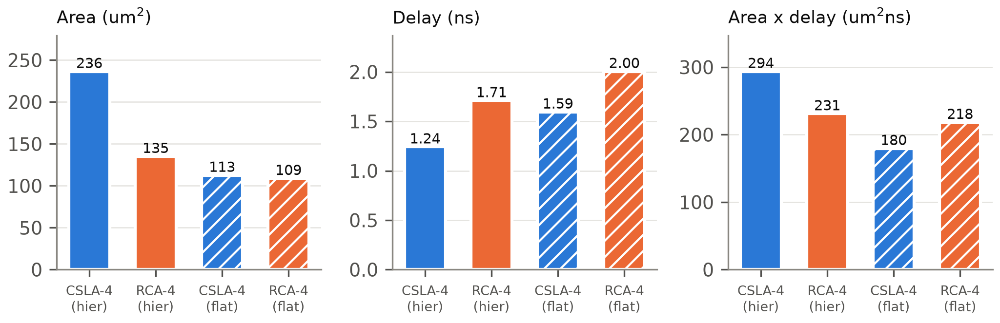

# Tổng hợp và phân tích thời gian tĩnh

## Tổng hợp bằng Yosys

Script `syn/synth.ys` đọc các file RTL, giữ phân cấp của `fa` và `mux2` (quyết định D-6), chạy `synth`, ánh xạ flip-flop bằng `dfflibmap` và logic tổ hợp bằng `abc` với liberty `sky130_fd_sc_hd__tt_025C_1v80.lib`. Hai điều chỉnh so với đề cương được ghi trong `docs/DEVIATIONS.md`:

- D2: đặt tên cell theo tên wire (`rename -wire`) để report STA chỉ rõ đường đi qua thanh ghi nào.
- D3: loại các cell `lpflow_*` (cell cách ly cho power gating) khỏi ánh xạ, giống như LibreLane.

## Ràng buộc thời gian (SDC)

File `syn/constraints.sdc` dùng chung cho tổng hợp, STA và LibreLane (quyết định D-7):

- `create_clock` chu kỳ 10 ns trên `clk`; `set_clock_uncertainty` 0.25 ns; `set_clock_transition` 0.15 ns.
- `set_input_delay` 2 ns cho mọi ngõ vào trừ `clk` (gồm cả `rst_n`); `set_output_delay` 2 ns.
- `set_driving_cell sky130_fd_sc_hd__inv_2` cho ngõ vào; `set_load` 0.0334 pF cho ngõ ra.

## Diện tích

Bảng: Kết quả tổng hợp `carryselect4_top`
| Chỉ số | Giá trị |
|---|---|
| Số cell | {{synth.top.cell_count}} |
| Số flip-flop / latch | {{synth.top.ff_count}} / {{synth.top.latch_count}} |
| Diện tích cell (µm²) | {{synth.top.area_um2}} |
| Diện tích NAND2 (µm²) | {{synth.nand2_area_um2}} |
| NAND2 tương đương | {{synth.top.nand2_eq}} |
| Ngân sách đề cương | 500 |

NAND2 tương đương được tính theo quyết định D-5: tổng diện tích cell chia cho diện tích `sky130_fd_sc_hd__nand2_1` đọc từ liberty. Thiết kế dùng chưa tới một nửa ngân sách 500 cổng.

## Phân tích thời gian tĩnh (OpenSTA)

Ở corner tt (25 °C, 1.8 V) với clock lý tưởng, OpenSTA báo:

Bảng: Kết quả STA sau tổng hợp (corner tt, chu kỳ 10 ns)
| Kiểm tra | Đường | Slack (ns) |
|---|---|---|
| Setup xấu nhất (toàn thiết kế) | `{{sta.synth.worst_path}}` | {{sta.synth.wns_setup_ns}} |
| Hold xấu nhất | trạng thái FSM | {{sta.synth.wns_hold_ns}} |
| Đường tới hạn thanh ghi–thanh ghi | `{{sta.synth.crit_path}}` | thời điểm đến {{sta.synth.crit_arrival_ns}} ns |

Theo D1, các key `wns_*` lưu **worst slack** (dương khi đạt timing) thay vì WNS của OpenSTA, vì WNS bằng 0 khi không có vi phạm và không cho biết còn dư bao nhiêu. Đường setup xấu nhất toàn thiết kế bắt đầu từ cổng vào `valid_in` vì ràng buộc input delay 2 ns. Đường tới hạn thanh ghi–thanh ghi đi đúng qua cấu trúc CSLA: hai cổng `maj3` của khối low tạo `c2`, rồi chân chọn của MUX:

Bảng: Đường tới hạn `a_q[0] → cout_q` (trích `results/logs/t6_sta.txt`)
| Chân | Cell | Trễ (ns) | Thời điểm (ns) |
|---|---|---|---|
| `a_q[0]/Q` | `dfrtp_1` | 0.418 | 0.418 |
| `u_low/u_fa0/cout` | `maj3_1` | 0.367 | 0.785 |
| `u_low/u_fa1/cout` (= `c2`) | `maj3_1` | 0.401 | 1.187 |
| `u_mux_co/y` (chân S → X) | `mux2_1` | 0.316 | 1.503 |
| MUX ngõ ra (`out_en`) | `mux2_1` | 0.281 | 1.784 |
| `cout_q/D` | `dfrtp_1` | – | 1.784 |

## So sánh Area–Delay giữa CSLA-4 và RCA-4

Để đánh giá công bằng, hai bộ cộng tổ hợp `csla4` và `rca4` được tổng hợp riêng, mỗi loại hai biến thể: giữ phân cấp (giống thiết kế cuối) và cho phép flatten. Độ trễ là thời gian đến dài nhất từ ngõ vào tới ngõ ra với clock ảo, input/output delay bằng 0, corner tt.

Bảng: So sánh diện tích và độ trễ (Task 7)
| Biến thể | Diện tích (µm²) | NAND2 tđ | Số cell | Trễ (ns) | ADP (µm²·ns) |
|---|---|---|---|---|---|
| CSLA-4 (phân cấp) | {{cmp.csla4.area_um2}} | {{cmp.csla4.nand2_eq}} | {{cmp.csla4.cell_count}} | {{cmp.csla4.delay_ns}} | {{cmp.csla4.adp}} |
| RCA-4 (phân cấp) | {{cmp.rca4.area_um2}} | {{cmp.rca4.nand2_eq}} | {{cmp.rca4.cell_count}} | {{cmp.rca4.delay_ns}} | {{cmp.rca4.adp}} |
| CSLA-4 (flatten) | {{cmp.csla4_flat.area_um2}} | {{cmp.csla4_flat.nand2_eq}} | {{cmp.csla4_flat.cell_count}} | {{cmp.csla4_flat.delay_ns}} | {{cmp.csla4_flat.adp}} |
| RCA-4 (flatten) | {{cmp.rca4_flat.area_um2}} | {{cmp.rca4_flat.nand2_eq}} | {{cmp.rca4_flat.cell_count}} | {{cmp.rca4_flat.delay_ns}} | {{cmp.rca4_flat.adp}} |

Nhận xét (theo `results/logs/t7.txt`):

- **Khi giữ phân cấp**, CSLA nhanh hơn RCA ({{cmp.csla4.delay_ns}} so với {{cmp.rca4.delay_ns}} ns) nhưng diện tích lớn gần gấp đôi, nên tích diện tích–độ trễ (ADP) **kém hơn** RCA.
- **Khi flatten**, ABC tối ưu diện tích mạnh (CSLA giảm khoảng một nửa) nhưng cả hai đều chậm đi. CSLA flatten vẫn nhanh hơn RCA flatten và có ADP tốt nhất trong 4 biến thể.
- Như vậy lợi thế cấu trúc của CSLA vẫn còn sau flatten, nhưng ở độ rộng 4 bit, khối bit cao bị nhân đôi tốn gần bằng phần độ trễ tiết kiệm được. Thiết kế cuối dùng bản giữ phân cấp (D-6), nên ưu thế tốc độ của CSLA là thật nhưng phải trả bằng diện tích.
- Hai giả thuyết chưa được kiểm chứng: ABC ưu tiên diện tích hơn tốc độ khi ánh xạ; và 4 bit là quá ngắn để carry-select phát huy hết lợi thế.
