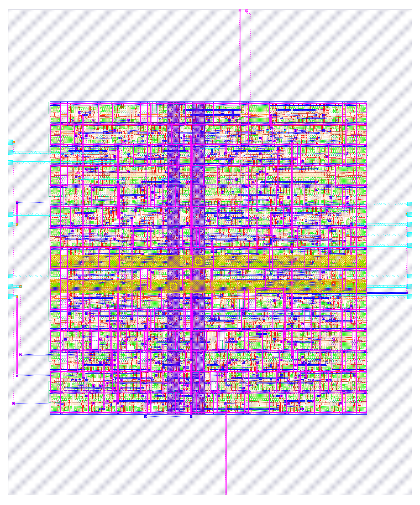

# Thiết kế vật lý

## Luồng OpenLane 2 / LibreLane

Nhóm dùng LibreLane 3.0.16 (bản kế tục OpenLane 2) với file cấu hình `pnr/config.json`. Các thông số chính là `CLOCK_PERIOD = 10`, `FP_CORE_UTIL = 55`, `FP_ASPECT_RATIO = 1` và `SYNTH_HIERARCHY_MODE = keep` để giữ phân cấp CSLA (D-6). `PNR_SDC_FILE` và `SIGNOFF_SDC_FILE` đều trỏ tới `syn/constraints.sdc`, cùng file với chương 5. Lệnh chạy là `make pnr` (`scripts/run_pnr.sh 10 run_10ns`).

Luồng đi qua bảy bước. Đầu tiên là tổng hợp bằng Yosys cùng các kiểm tra lint, latch và cell chưa ánh xạ. Sau đó là floorplan, với kích thước die tính theo utilization 55% và tỷ lệ 1:1, có chèn tap cell và end cap. Mạng cấp nguồn (PDN) gồm lưới VPWR/VGND trên met4/met5 và rail met1 theo hàng cell. Bước placement đặt chân I/O rồi chạy global và detailed placement. CTS dựng cây clock và sửa timing bằng cách chèn buffer. Bước routing gồm global route, sửa antenna, detailed route và chèn fill/decap. Cuối cùng là sign-off: trích RC, STA ở 9 corner, DRC bằng Magic và KLayout, LVS bằng Netgen và xuất GDSII.

Flow chạy bằng `make pnr` ở chế độ `--dockerized`, với image `ghcr.io/librelane/librelane:3.0.16` và PDK sky130A do ciel quản lý (hash `{{env.pdk_hash}}`). Mọi số `pnr.*` và `pnr5.*` trong tài liệu được đo bằng chế độ này (xem D4). Lệnh `docker run -it` của LibreLane cần một TTY, nên khi chạy từ script không có terminal thì `run_pnr.sh` bọc lệnh bằng `script`.

## Kết quả sign-off

Bảng: Kết quả sau đặt–đi dây ở chu kỳ 10 ns
| Chỉ số | Giá trị |
|---|---|
| Diện tích die (µm²) | {{pnr.die_area_um2}} |
| Số standard cell (gồm tap, không gồm fill) | {{pnr.cell_count}} |
| Utilization cuối (%) | {{pnr.core_util_pct}} |
| Setup slack ở tt / corner xấu nhất (ns) | {{pnr.wns_setup_ns}} / {{pnr.wns_setup_worst_corner_ns}} |
| Hold slack ở tt / corner xấu nhất (ns) | {{pnr.wns_hold_ns}} / {{pnr.wns_hold_worst_corner_ns}} |
| fmax ước lượng ở tt (MHz) | {{pnr.fmax_mhz}} |
| Lỗi DRC Magic / KLayout | {{pnr.drc_magic}} / {{pnr.drc_klayout}} |
| Lỗi LVS | {{pnr.lvs_errors}} |
| Vi phạm antenna | {{pnr.antenna_violations}} |
| Công suất tổng (mW) | {{pnr.power_total_mw}} |
| Chiều dài dây (µm) | {{pnr.wirelength_um}} |

Setup và hold slack đều dương ở cả 9 corner (trích RC min/nom/max, kết hợp ss/tt/ff), kể cả corner chậm nhất `max_ss_100C_1v60`. Các kiểm tra recovery và removal của `rst_n` nằm trong nhóm đường `asynchronous` và đã được tính vào slack này. Nhóm kiểm tra cả 9 corner chứ không chỉ corner tt, vì setup slack xấu nhất nằm ở corner ss.

fmax được ước lượng bằng 1000 / (*T* − *s*) MHz, với *T* = 10 ns và *s* là setup slack ở tt (worst slack, D1). Slack này tính cả đường I/O, mà input/output delay cố định 2 ns không đổi theo chu kỳ, nên *T* − *s* là chu kỳ nhỏ nhất mà đường chặt nhất chịu được. Đây là tần số ước lượng ở corner tt, chưa phải giá trị đã sign-off.

Utilization cuối cao hơn mục tiêu 55%. Lý do là sau floorplan, các bước sửa timing chèn thêm buffer (gồm buffer hold), trong khi die vẫn giữ nguyên kích thước tính ở floorplan. Nhóm giữ nguyên cấu hình 55% theo đề cương và ghi nhận chênh lệch này thay vì chỉnh số để cho đẹp.

## Chạy mở rộng ở 5 ns

{{pnr5.text_vi}}

## Sai khác so với đề cương

Mọi sai khác đều nằm trong `docs/DEVIATIONS.md`. Với phần vật lý và tổng hợp có năm mục.

D1: các key `*.wns_*` lưu worst slack (dương khi đạt) thay cho WNS của OpenSTA, để biết còn dư bao nhiêu. D2: thêm `read_liberty -lib` và `rename -wire` để report STA đọc được tên thanh ghi; logic và diện tích không đổi. D3: loại cell `lpflow_*`, tránh dùng cell cách ly làm logic thường, giống cách LibreLane làm; số cell và diện tích không đổi.

D4: lần chạy đầu trong môi trường không có Docker dùng tool native và PDK `open_pdks` 1.0.471. Số trong tài liệu là số chạy lại bằng image LibreLane 3.0.16 và PDK ciel, còn số của lần đầu chỉ còn là lịch sử. Hai lần chạy cho kết luận 5 ns khác nhau, nên nhóm chỉ trích số của lần chạy chính thức. D5: bài báo dựng bằng TeX Live khi máy không có tectonic; nội dung và lớp IEEEtran không đổi.
