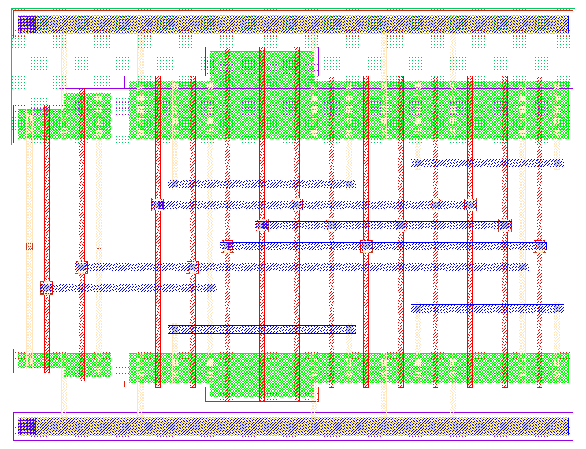
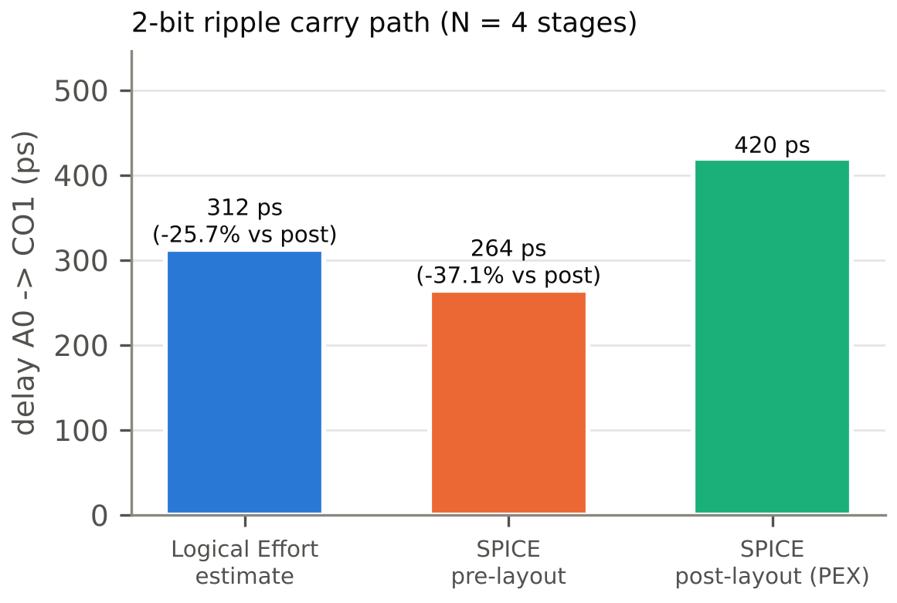
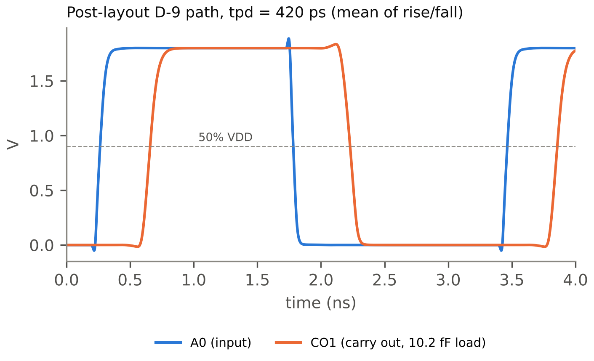

# Full Adder full-custom và Logical Effort

## Mạch mirror adder 28T

Tế bào Full Adder được thiết kế ở mức transistor theo cấu trúc **mirror adder** 28 transistor, gồm bốn khối:

- **Carry gate** (10T) tạo `COb` = NOT MAJ(A, B, CI). Mạng kéo xuống (PDN) gồm nhánh `CI` nối tiếp với (`A` song song `B`) và nhánh `A` nối tiếp `B`; mạng kéo lên (PUN) có đúng cùng topology ("gương"), vì hàm đa số là tự đối ngẫu.
- **Sum gate** (14T) tạo `Sb` = NOT (A ⊕ B ⊕ CI), dùng lại `COb`: PDN dẫn khi (A + B + CI)·COb hoặc A·B·CI.
- Hai **inverter** tạo `CO` từ `COb` và `S` từ `Sb`.

Netlist dùng `sky130_fd_pr__nfet_01v8` và `sky130_fd_pr__pfet_01v8`, chiều dài kênh nhỏ nhất của PDK, subckt `fa_cell A B CI S CO VPWR VGND`. Mô phỏng chức năng (`custom/fa/sim/fa_func.sp`) quét đủ 8 tổ hợp vào và so với bảng chân trị ngay trong ngspice: kết quả 8/8 đúng.

## Đặc trưng hóa τ

Inverter đơn vị có Wn = {{le.wn_unit_um}} µm. Wp được quét trong ba giá trị và chọn Wp = {{le.wp_unit_um}} µm vì cho trễ lên và xuống cân bằng nhất ở FO4. Mô phỏng chuỗi inverter (tầng trước tạo sườn thực, tầng đo tải đúng 4 inverter giống nó) ở corner tt, 1.8 V, 27 °C cho:

Bảng: Kết quả đặc trưng hóa inverter
| Đại lượng | Giá trị |
|---|---|
| FO4 (ps) | {{le.fo4_ps}} |
| τ = FO4 / 5 (ps) | {{le.tau_ps}} |
| p_inv (trễ không tải / τ) | {{le.pinv}} |
| C chân S của `mux2_1` (fF, liberty tt) | {{le.c_mux_s_ff}} |

## Kích thước theo Logical Effort

**Đường phân tích** (quyết định D-9): `a0` → carry gate FA0 → inverter → `c1` → carry gate FA1 → inverter → `c2`, tức *N* = {{le.N}} tầng. Tải tại `c2` là 3 chân chọn MUX: *C_load* = 3 × {{le.c_mux_s_ff}} fF.

Từng bước tính:

1. **Logical effort:** *g_carry* = 2, *g_inv* = 1, nên *G* = 2 × 1 × 2 × 1 = {{le.G}}.
2. **Branching effort** tính từ tổng độ rộng cổng (*C = W·C_g*, với *C_g* lấy từ điện dung chân A và độ rộng transistor của `sky130_fd_sc_hd__inv_1`). Tại `COb` tín hiệu đi vào inverter `CO` và rẽ sang chân `COb` của sum gate; tại `CO` của FA0 tín hiệu đi vào chân `CI` của carry gate FA1 và rẽ sang chân `CI` của sum gate FA1. Kết quả *B* = {{le.B}}.
3. **Electrical effort:** *H = C_load / C_in(A)* = {{le.H}}, với *C_in(A)* là điện dung chân A của carry gate FA0.
4. **Path effort:** *F = G·B·H* = {{le.F}}; effort mỗi tầng *f̂ = F^(1/4)* = {{le.fhat}}.
5. **Ký sinh:** *p_carry* = {{le.p_carry}} (mô phỏng carry gate không tải chia cho τ); *P* = 2·*p_carry* + 2·*p_inv*.
6. **Độ trễ ước lượng:** *D = N·f̂ + P* = {{le.D_est_tau}} τ = **{{le.D_est_ps}} ps**.

**Hai phương án kích thước:**

- **S1:** mỗi transistor có *W = k × W_unit*, với *k* là số transistor nối tiếp trên nhánh của nó (k = 2 cho carry gate và nhánh 2 tầng của sum gate, k = 3 cho nhánh A–B–CI nối tiếp). Inverter đầu ra dùng kích thước đơn vị.
- **S2:** giống S1, nhưng inverter `CO` lấy kích thước tầng cuối từ `optimal_sizes` (tính ngược từ tải).

Bảng: So sánh hai phương án kích thước (SPICE trước layout, đường D-9)
| Phương án | Trễ (ps) |
|---|---|
| S1 | {{fa.s1.delay_pre_ps}} |
| S2 | {{fa.s2.delay_pre_ps}} |
| Được chọn | {{fa.sizing_chosen}} |

S2 nhanh hơn rõ rệt (hơn 3%), nên được chọn và copy thành `custom/fa/fa_cell.spice`; layout và LVS dùng đúng file này.

## Layout và Euler path

Layout được sinh bằng script (`custom/fa/gen_layout.py`) từ chính netlist đã chọn, rồi lưu thành `fa_cell.mag` cho Magic. Các quy tắc chính (chi tiết trong `custom/fa/euler.md`):

- **Euler path:** carry gate có hai nút bậc lẻ nên có Euler path; sum gate có mọi nút bậc chẵn nên có Euler circuit đi từ VPWR về VPWR. Ghép sum gate rồi tới carry gate tại nút VPWR chung, hai inverter chia chung một tiếp xúc VPWR. Kết quả là mỗi hàng chỉ có **một chỗ ngắt diffusion** (giữa dải inverter và dải sum+carry).
- **Cột poly dùng chung:** vì PDN là ảnh gương của PUN, cùng một thứ tự cổng dùng cho cả hàng p và hàng n, mỗi cột poly đi thẳng từ pMOS xuống nMOS.
- **Đi dây:** li dọc từ tiếp xúc diffusion; 9 track met1 ngang giữa hai hàng cho A, B, CI, COb, Sb và các nút trong được nối bằng kim loại; rail VPWR/VGND bằng met1.
- **Tap chống latch-up:** một dải n-tap (nối VPWR, trong nwell) và một dải p-tap (nối VGND) chạy hết chiều rộng dưới hai rail. Luật latch-up sky130 trong deck Magic là LU.2 / LU.3: mọi điểm diffusion phải cách tap loại ngược < 15 µm; khoảng cách xa nhất đo được chỉ vài µm.

Bảng: Kết quả layout Full Adder
| Chỉ số | Giá trị |
|---|---|
| Kích thước (µm) | {{fa.width_um}} × {{fa.height_um}} |
| Diện tích (µm²) | {{fa.area_um2}} |
| Số transistor sau trích | {{fa.ntrans}} |
| Số dải tap | {{fa.taps}} |
| Lỗi DRC (`drc(full)`) | {{fa.drc_errors}} |
| LVS khớp (Netgen) | {{fa.lvs_match}} |
| Số tụ ký sinh khác 0 (PEX) | {{fa.pex_cap_count}} |

**DRC** chạy với `drc style drc(full)` của sky130A. Lỗi duy nhất gặp trong quá trình vẽ là li.5 (li phải phủ tiếp xúc diffusion ít nhất 0.08 µm ở hai phía đối diện); sửa trong script sinh layout xong thì DRC bằng 0. **LVS** so netlist trích từ Magic (`ext2spice lvs`) với `fa_cell.spice` bằng Netgen và setup `sky130A_setup.tcl`: "Circuits match uniquely", 28 thiết bị, 19 net, không có lỗi thuộc tính W/L. **PEX** dùng `ext2spice cthresh 0 rthresh 0` ở định dạng ngspice, giữ tên subckt và thứ tự chân.

## So sánh Logical Effort và SPICE

Mạch đo trước và sau layout giống hệt nhau (`path_pre.sp` và `path_post.sp`), chỉ khác netlist được include: hai `fa_cell` nối thành RCA 2 bit, B0 = 1, CI0 = 0, A1 = 1, B1 = 0 để nhớ lan qua cả hai tầng, tải 3 chân chọn MUX tại `CO1`. Độ trễ là trung bình hai sườn từ `A0` tới `CO1`, đo ở 50%.

Bảng: Độ trễ đường D-9 theo ba phương pháp
| Phương pháp | Trễ (ps) | Sai số của LE |
|---|---|---|
| Logical Effort | {{le.D_est_ps}} | – |
| SPICE trước layout | {{spice.D_pre_ps}} | {{le.err_pre_pct}} % |
| SPICE sau layout (PEX) | {{spice.D_post_ps}} | {{le.err_post_pct}} % |

## Phân tích nguồn sai số

- **Trước layout, LE chậm hơn SPICE.** Mô hình LE dùng một giá trị *g* và *p* cố định cho mỗi loại cổng và giả định sườn vào "chuẩn". Thực tế pMOS của sky130 tương đối mạnh ở độ rộng nhỏ (Wp/Wn = 2 đã cân bằng), và đường đo chỉ có 4 tầng nên sai số của *p_carry* chiếm tỷ trọng lớn.
- **Sau layout, SPICE chậm hơn LE nhiều.** Netlist schematic không có diện tích và chu vi source/drain (`ad`, `as`, `pd`, `ps`), nên mô phỏng trước layout bỏ qua toàn bộ điện dung tiếp giáp. Netlist PEX có các tham số này cho cả 28 transistor, cộng thêm điện dung dây: chân A, B, CI mỗi chân cỡ 4 fF do 9 track met1 chạy dọc cell, và nút `COb` cỡ 3.9 fF. Tổng hai phần này làm trễ tăng từ {{spice.D_pre_ps}} lên {{spice.D_post_ps}} ps.
- **Cách cải thiện:** đưa điện dung tiếp giáp và dây vào *p* của từng tầng (layout-aware parasitic), hoặc thu gọn layout (bớt track, dùng diffusion chung nhiều hơn) để giảm điện dung dây.

Kết luận: Logical Effort chọn đúng phương án kích thước nhanh hơn (S2) và cho ước lượng nằm giữa kết quả trước và sau layout, nhưng để dự đoán chính xác độ trễ tuyệt đối thì phải tính thêm ký sinh của layout.
